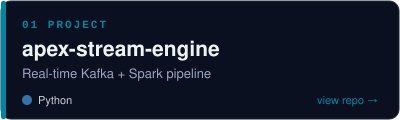
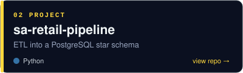
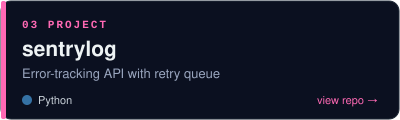
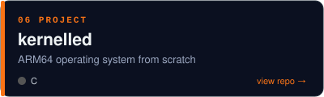

  

  

  
  
  

## About

<table>
<tr>
<td width="55%" valign="top">

Hi, I'm **Nelisiwe Nkwanyana**, a **final-year Business Information Systems** student at **STADIO Higher Education** in Pretoria, South Africa.

I build **data pipelines**, **backend APIs** and **full-stack web apps**, and I like understanding how things work underneath, down to writing my own operating system.

- 🔭 Shipping projects in **Python, SQL, FastAPI, Kafka, Spark and React**
- 🎓 Graduating **December 2026** · average 72%, 7 distinctions
- 💼 Looking for **graduate Software Engineer / Data Engineer** roles in 2027

</td>
<td width="45%" valign="middle" align="center">
  
</td>
</tr>
</table>

  

## Stack

  
   
  
   
  

## Selected work

<table>
<tr>
<td></td>
<td></td>
</tr>
<tr>
<td></td>
<td></td>
</tr>
<tr>
<td></td>
<td></td>
</tr>
</table>

## Contact

  
  
  

